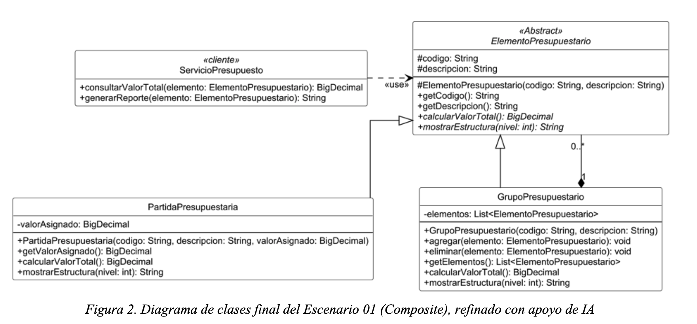

# Patrones de Diseño de Software

## Actividad 02: Patrones Estructurales

### Patrón Composite

| | |
|---|---|
| **Asignatura** | Patrones de Diseño de Software |
| **Actividad** | 02. Patrones Estructurales |
| **Patrón** | Composite |
| **Escenario** | 01. Estructura jerárquica de un presupuesto institucional |

Aplicación web en **React + TypeScript** que implementa el diagrama de clases del Escenario 01 y permite explicar el patrón Composite de forma interactiva: se puede explorar el árbol presupuestario, ver cómo se ejecuta la recursión paso a paso y hacer crecer la estructura sin tocar el código del cliente.

---

## 1. Cómo ejecutar el proyecto en modo desarrollo

### Requisitos

- [Node.js](https://nodejs.org/) 18 o superior (se probó con Node 22)
- npm (viene con Node.js)

Para comprobarlo:

```bash
node --version
npm --version
```

### Pasos

```bash
# 1. Entrar a la carpeta del proyecto
cd composite-presupuesto

# 2. Instalar dependencias (solo la primera vez)
npm install

# 3. Levantar el servidor de desarrollo
npm run dev
```

Vite abre el navegador automáticamente en **http://localhost:5173**. Si no se abre, copia esa dirección en el navegador. Los cambios que hagas en `src/` se reflejan al instante, sin recargar.

Para detener el servidor, presiona `Ctrl + C` en la terminal.

### Otros comandos

| Comando | Qué hace |
|---|---|
| `npm run dev` | Servidor de desarrollo con recarga en caliente |
| `npm run typecheck` | Verifica los tipos de TypeScript sin generar archivos |
| `npm test` | Ejecuta las pruebas unitarias con Vitest |
| `npm run build` | Verifica los tipos y genera la versión de producción en `dist/` |
| `npm run preview` | Sirve localmente la carpeta `dist/` para revisarla |

### Problemas frecuentes

- **El puerto 5173 está ocupado.** Vite elige el siguiente disponible y lo muestra en la terminal.
- **Las tipografías no cargan sin internet.** La app usa IBM Plex desde Google Fonts. Sin conexión se usan las fuentes del sistema y todo sigue funcionando.
- **`npm install` falla.** Revisa la versión de Node (`node --version`, mínimo 18) y la conexión a internet.
- **El editor marca errores en los imports.** Ejecuta `npm install` primero y reinicia el servidor de TypeScript del editor.

---

## 2. El escenario

Una institución necesita representar su presupuesto en varios niveles jerárquicos. Existen **partidas individuales** (código, descripción y valor asignado) y **grupos presupuestarios** que pueden contener partidas y también otros grupos. Todos deben permitir obtener su código y descripción, calcular su valor total y mostrar su estructura. El cliente no debe distinguir entre partida y grupo, y la estructura debe poder crecer sin modificar la lógica que la consulta.

El enunciado completo está en [`docs/escenario01.md`](docs/escenario01.md).

## 3. Solución con Composite



| Rol en el patrón | Clase | Archivo | Responsabilidad |
|---|---|---|---|
| Component | `ElementoPresupuestario` (abstracta) | `src/domain/ElementoPresupuestario.ts` | Interfaz común: `getCodigo()`, `getDescripcion()`, `calcularValorTotal()`, `mostrarEstructura(nivel)` |
| Leaf | `PartidaPresupuestaria` | `src/domain/PartidaPresupuestaria.ts` | Su total es su `valorAsignado` |
| Composite | `GrupoPresupuestario` | `src/domain/GrupoPresupuestario.ts` | Guarda `elementos` (partidas u otros grupos) y suma sus totales de forma recursiva |
| Client | `ServicioPresupuesto` | `src/domain/ServicioPresupuesto.ts` | Consulta totales y genera reportes usando solo `ElementoPresupuestario` |

### Cómo se traduce el diagrama a TypeScript

| En el diagrama | En el código |
|---|---|
| `«Abstract» ElementoPresupuestario` | `abstract class` con métodos `abstract` |
| `#codigo`, `#descripcion` | `protected codigo`, `protected descripcion` |
| `#ElementoPresupuestario(...)` | `protected constructor` |
| `-valorAsignado`, `-elementos` | `private` |
| `BigDecimal` | `number` redondeado a centavos |
| `List<ElementoPresupuestario>` | `ElementoPresupuestario[]` |

### Puntos clave del diseño

- El cliente (`ServicioPresupuesto`) no tiene ningún `instanceof` ni `if` por tipo, y su firma solo menciona `ElementoPresupuestario`.
- `agregar()`, `eliminar()` y `getElementos()` existen solo en `GrupoPresupuestario`, como en el diagrama (variante con seguridad de tipos). Con TypeScript, intentar llamar `agregar()` sobre una partida es un error de compilación.
- Un nuevo nivel de agrupación es una instancia más de `GrupoPresupuestario`. Un nuevo tipo de elemento es una subclase de `ElementoPresupuestario`. En ambos casos el cliente no cambia (hay una prueba que lo demuestra).
- `BigDecimal` no existe en JavaScript. Se usa `number` redondeado a centavos; para un sistema real conviene usar enteros en centavos o una librería decimal.

## 4. Qué muestra la aplicación

- **Simulador.** Árbol del presupuesto con el total de cada nodo, obtenido llamando al mismo método sobre partidas y grupos. Al seleccionar un elemento se ve la recursión paso a paso (qué clase responde en cada llamada), el reporte de `mostrarEstructura()` y un formulario para agregar partidas o grupos, eliminarlos y cambiar valores.
- **El patrón.** Problema que resuelve (con y sin Composite), tabla de roles, diagrama de clases redibujado y decisiones de diseño con sus costos.
- **Código.** Los archivos reales de `src/domain/` y un ejemplo de uso.

### Sugerencia para exponer

1. Abrir el simulador y seleccionar una **partida**: la traza tiene una sola llamada.
2. Seleccionar `TI-INF` y pulsar **Reproducir**: se ve cómo la llamada baja por los grupos y vuelve sumando.
3. Agregar un grupo dentro de `INF-COM` y una partida dentro de él: cambian los totales de todos los ancestros y `ServicioPresupuesto` sigue igual.
4. Seleccionar una partida y comprobar que no admite `agregar()`.

## 5. Estructura del proyecto

```
composite-presupuesto/
├── docs/
│   ├── escenario01.md          Enunciado del escenario
│   └── diagrama-clases.png     Diagrama de clases de la solución
├── src/
│   ├── domain/                 Clases del diagrama (TypeScript puro, sin React)
│   │   ├── ElementoPresupuestario.ts
│   │   ├── PartidaPresupuestaria.ts
│   │   ├── GrupoPresupuestario.ts
│   │   ├── ServicioPresupuesto.ts
│   │   ├── formato.ts          moneda() y redondear()
│   │   ├── ejemplo.ts          Datos de ejemplo del escenario
│   │   └── index.ts
│   ├── utils/                  Ayudas de la interfaz (recorrer árbol, traza, resaltado)
│   ├── components/             Simulador, Nodo, Patron, Diagrama, CodigoTab, ...
│   ├── App.tsx
│   ├── main.tsx
│   ├── styles.css
│   └── vite-env.d.ts
├── tests/
│   └── composite.test.ts       Pruebas con Vitest
├── index.html
├── tsconfig.json               TypeScript en modo estricto
├── vite.config.ts
└── package.json
```

La carpeta `src/domain/` no depende de React: se puede copiar a cualquier otro proyecto TypeScript. React solo se usa para dibujar y para interactuar.

## 6. Tecnologías

React 18 · TypeScript 5 (modo `strict`) · Vite 5 · Vitest 2.
